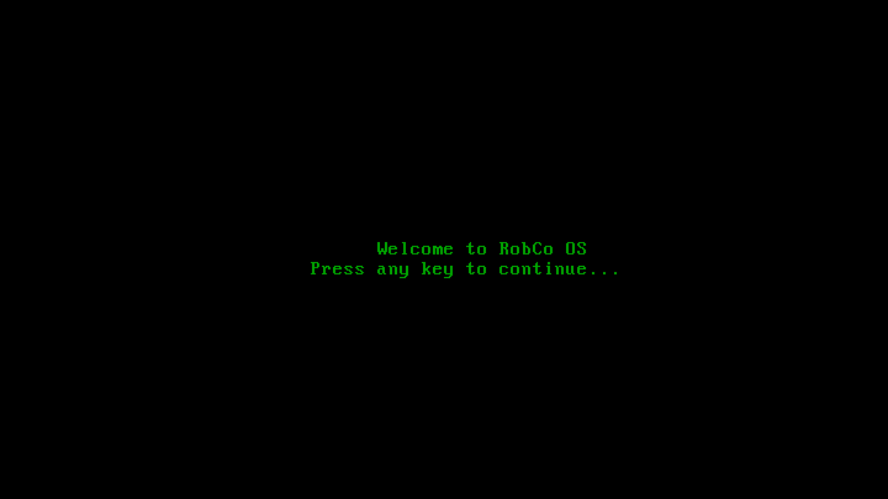

# myOS

Experimento de sistema operacional com código de inicialização, kernel em C e artefatos de demonstração.

**Arquivos principais**

- [boot.s](<boot.s>)
- [kernel.c](<kernel.c>)
- [grub.cfg](<grub.cfg>)

